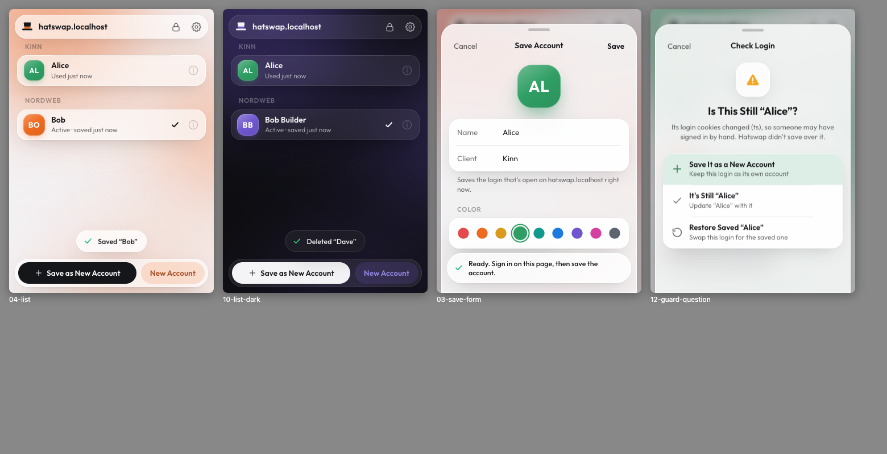

# Hatswap

A Chrome extension (Manifest V3) for switching between several accounts on the same website with one click, without logging out and back in. Built for tools where you manage several clients: Buffer, Meta Business Suite, Shopify, Google services and the like.

Everything stays on your computer. Saved sessions are encrypted with a master password, and Hatswap makes no network requests at all.



The popup has its own look: frosted glass surfaces over a soft colour wash that takes the active account's colour, so the whole popup changes tone when you switch. Pill shapes, the bundled Outfit typeface (SIL OFL, in `extension/fonts/`), and the hat as the hero. Switching makes a glass pill flow to the chosen account while the hat tips and its band changes colour. Sheets rise on a spring while the list sinks and blurs behind them. It follows the Mac's light/dark mode and its Reduce Motion, Reduce Transparency and Increase Contrast settings. [`docs/hatswap-preview.mp4`](docs/hatswap-preview.mp4) is a 24-second dark-mode recording of it in motion.

## Install

1. Open `chrome://extensions` and turn on **Developer mode** (top right).
2. Click **Load unpacked** and pick the `extension/` folder (the one with `manifest.json`).
3. Pin Hatswap to the toolbar (puzzle-piece icon → pin).

Requires Chrome 120 or newer. No build step: the folder is the extension.

## Use

**First run.** Click the Hatswap icon. You'll see what Hatswap stores and why it matters, then pick a master password (8+ characters) and an auto-lock time.

**Save your first account.** Sign in to the site as usual, open Hatswap and click **Save as new account**. Give it a name, a client/group (for example "Kinn" or "NordWeb") and a color. The first time, Chrome asks you to give Hatswap access to that site (for example `buffer.com` and its subdomains). Access is per site; Hatswap never asks for all sites.

**Add the next account.** Click **New account**. That clears the site's session in this browser (it does *not* log you out on the server), so you can sign in with the other account and click **Save as new account** again.

**Switch.** Click an account. Hatswap saves the current session into the active account first (so refreshed tokens aren't lost), stops the site's open pages, swaps the cookies and storage, and loads the site again. By default the tab opens the page you were last on with that account. You can change that to "reload" in settings.

If the site throws the restored session away (usually because it expired on the server), the badge turns into a red **!** and the popup says so. Sign in to that account on the page, then click **Update** in the popup.

**Also:**

- The toolbar badge shows the active account's initials in its color, per tab.
- **⌥⇧H** (Alt+Shift+H) switches to the next account on the current site. "Previous account" and "Open Hatswap" can be given shortcuts at `chrome://extensions/shortcuts` (Settings → Change shortcuts…).
- With more than four accounts on a site you get a search field. Start typing anywhere, use ↑/↓, and press Enter to switch.
- **⋯** on an account lets you rename it, change its group or color, replace its saved session with the current one, or delete it (with confirmation).
- The lock icon locks Hatswap right away. Settings has auto-lock, auto-save, change master password and erase everything.
- Inside the popup on a Mac: **⌘,** opens Settings, **⌘F** searches, **⌘L** locks, **Esc** goes back or closes a sheet.

### Two rules that keep saved accounts working

1. **Never click "Log out" inside the site for an account you've saved.** Logging out kills that session on the server, and the saved copy dies with it. Use **New account** instead.
2. **Don't save the same login twice.** Two copies of one session break as soon as the site rotates its tokens. Using one copy invalidates the other. The save form tells you when the session looks like the active account.

### Signed in by hand? Hatswap asks first

Before you switch, auto-save copies the live session into the active account. If you signed in to a different account without Hatswap (or cleared the site's cookies), that would overwrite the wrong account. So Hatswap first checks whether the live session still looks like the active account. If it doesn't, nothing is saved and you get a question:

- **Save it as a new account**, then carry on with the switch.
- **It's still "Kinn"**: save it anyway. Hatswap remembers that the cookies that changed rotate on their own and won't ask about them again.
- **Switch without saving it**, or **Restore saved "Kinn"** to put the saved session back.

The popup shows a yellow banner whenever the live session has drifted, and the keyboard shortcut refuses to switch (the badge shows **?**) until you've answered.

How it decides: Hatswap only looks at httpOnly cookies, since login cookies almost always are and analytics or preference cookies usually aren't. It skips bot-protection and load-balancer cookies and anything that expires within a day. For each account it learns which of those cookies stay the same through a full cycle of use (switched to, used, saved back). If one of them is different or missing now, the session probably belongs to someone else. Until it has learned anything, it only asks when *none* of the saved login cookies is unchanged. It's a heuristic, so it can occasionally ask when nothing is wrong (answer "It's still …" once), and it can miss a manual login on a site whose login cookies never stay the same.

## Security

| What | How |
| --- | --- |
| Session data (cookies, localStorage, sessionStorage, last URL) | AES-256-GCM. The key comes from your master password with PBKDF2-SHA256 at 600,000 iterations and a random 16-byte salt. Each account is encrypted separately, with its id bound in as additional authenticated data. |
| Master password | Never stored. An encrypted check value tells a right password from a wrong one. |
| Key while unlocked | Kept in `chrome.storage.session`, which lives in memory only, is cleared when Chrome quits, and can't be read by content scripts. |
| Auto-lock | After N minutes without using Hatswap (1 min to 4 h, or "when Chrome closes"). Every operation checks the timeout before touching the key, and a timer wipes it on time while the service worker is awake. |
| Not encrypted | Account names, groups, colors and timestamps, so the badge can show the active account while Hatswap is locked. |
| Network | None. No telemetry, no servers, no remote code. |
| Messages | The service worker only accepts messages from the extension's own pages. |

**Permissions:** `cookies`, `storage`, `scripting`, `activeTab`, `tabs`, plus `optional_host_permissions: ["*://*/*"]`. The optional pattern only declares what *may* be requested. Real access is granted one site at a time when you first save an account there (pattern `*://*.example.com/*`). Hatswap gives the access back when you delete the last account for a site, and erasing everything removes all of it. `<all_urls>` is never requested.

Anyone with access to your unlocked Chrome profile can still use whatever account is currently signed in. That's true with or without Hatswap. Hatswap protects the *saved* sessions you're not using.

## How a switch works

1. **Auto-save.** Read every cookie for the site and its subdomains (httpOnly and partitioned CHIPS cookies included) plus localStorage/sessionStorage from every open tab on the site. Encrypt and store them in the active account, after the manual-login check above. This is skipped if the site has no cookies, so a jar you emptied by hand never overwrites a good snapshot.
2. **Restore storage and stop the old pages.** In every open tab on the site, replace localStorage/sessionStorage with the account's snapshot for that origin, block the old page from writing storage, cookies or new requests, and unload it to a blank page. Busy apps like Buffer always have API requests in flight, and their responses renew the session cookie. Without this step, a response that lands after the swap puts the old account back, and the switch looks like a plain reload.
3. **Delete cookies.** Remove every cookie for the site, repeating until none are left (cookies with the same name on the host and the parent domain shadow each other).
4. **Restore cookies.** Recreate the target account's cookies with their original domain or host-only scope, path, Secure, httpOnly, SameSite, expiry (expired ones are skipped, session cookies stay session cookies) and partition key.
5. **Load the site again.** Every parked tab goes back to its page (the active one to the account's last page) without leaving an extra history entry.
6. **Check.** Once the page has loaded, Hatswap checks that the site kept the session: no bounce to a login page, and the login cookies still look like the account's. If not, the account is flagged (red **!** badge, popup banner).

Pages Hatswap unloads don't get a "Leave site?" prompt, so unsaved text in a form on that site is lost when you switch.

Accounts are scoped to the registrable domain, so `publish.buffer.com` and `login.buffer.com` share the `buffer.com` accounts. Incognito windows have their own cookie jar and their own active-account marker.

## Known limitations

- **Device fingerprinting and IP checks.** Some apps tie a session to a browser fingerprint, an IP address or a device-bound key. Restoring cookies in the same Chrome profile usually passes. A site that ties sessions to something else can still sign you out or ask you to verify. Banks and some Google security flows behave like this.
- **IndexedDB, Cache Storage and service workers are not saved.** Apps that keep their login in IndexedDB (some Firebase-based apps, for example) won't switch fully. Hatswap only handles cookies plus localStorage/sessionStorage.
- **Storage is only captured from open tabs.** If an app keeps state on a subdomain you don't have open, that origin's storage isn't captured or restored. The previous snapshot for it is kept.
- **One site at a time.** Meta Business Suite runs on `facebook.com`, so switching it also switches your personal Facebook login in this browser. `instagram.com` is a separate site and isn't touched. The same goes for Google: `google.com` and `youtube.com` are switched separately. (Google also supports several accounts natively, which is often simpler.)
- **Third-party partitioned cookies** that other domains set under the site (embedded widgets) aren't touched, because Hatswap only has access to the site itself.
- **10 MB storage limit** in `chrome.storage.local`. A heavy app can store a lot in localStorage. Hatswap shows how much is used and gives a clear error when it's full.
- **Site detection** uses a built-in list of common multi-part suffixes (`co.uk`, `com.au`, `vercel.app`, …), not the full Public Suffix List.
- **Pages Chrome blocks** (chrome://, the Chrome Web Store, the PDF viewer) can't be switched. The popup explains why. If a page blocks scripts, cookies still switch and the popup lists what couldn't be restored.
- If Chrome closes, or you clear the site's cookies by hand, the saved copy may be one rotation behind. Sites that strictly rotate refresh tokens can then ask you to sign in again. The guard prevents overwriting, not staleness.

## Testing

`test-site/server.mjs` is a local two-account site (zero dependencies) that uses the session tricks real apps use. A switch only counts as working if all of them survive: a rotating httpOnly host-only session cookie, a parent-domain cookie, `__Host-` and `Secure` cookies, SameSite Strict/Lax/None, a partitioned (CHIPS) cookie, two cookies with the same name, a long-lived login cookie that rotates on `/?refresh=1`, a bearer token in localStorage, sessionStorage, and a second origin (`admin.`). The dashboard also polls the server constantly, and each slow response renews the session cookies it was sent with (a rolling session, like Buffer). That reproduces the "switch just reloads" race. An invalid session redirects to `/login`, and `POST /__expire?user=…` ends a user's sessions on the server.

```bash
node test-site/server.mjs
```

Open http://app.hatswap.localhost:8787. The test users are in `test-site/accounts.json`.

`tests/e2e.mjs` loads the extension into Playwright's Chromium and drives the real popup against that site: 125 checks covering setup, save, New account, switching back and forth after token rotation and with requests in flight, badge, shortcut, the manual-login guard (a self-rotating cookie, a manual sign-in, a shortcut press while drifted, a site that was signed out by hand), a saved session the server already ended, lock and auto-lock, edit, search, delete, password change, unsupported pages and erase.

```bash
PLAYWRIGHT=/path/to/node_modules/playwright node tests/e2e.mjs --out /tmp/hatswap-e2e
```

The test copy of the extension gets the test host as a pre-granted `host_permissions` entry, because automation can't click Chrome's permission dialog.

Developer hooks: `popup.html?tabId=<id>` opens the popup against a specific tab, and `hatswap.runCommand('switch-next')` in the service-worker console runs the shortcut.

Regenerate the icons with `node scripts/generate-icons.mjs`.

## Project structure

```
extension/           ← load this folder in chrome://extensions
  manifest.json
  background.js      service worker: switching, badge, shortcut, permission queue
  popup.html/.js/.css
  fonts/             Outfit, bundled (SIL OFL)
  lib/crypto.js      PBKDF2 + AES-GCM helpers (Web Crypto)
  lib/vault.js       storage layout, lock/unlock, auto-lock, settings
  lib/cookies.js     cookie snapshot / delete / restore
  lib/webstorage.js  localStorage / sessionStorage via chrome.scripting
  lib/identity.js    "is this still the same login?" heuristic
  lib/site.js        URL → site (registrable domain) and host pattern
  lib/accounts.js    colors, sorting, initials
  icons/             generated PNGs
scripts/generate-icons.mjs
site/                the homepage (index.html) and privacy policy, static, no build
scripts/github-pages-workflow.yml   optional Actions workflow that publishes site/
test-site/           local two-account test site
tests/e2e.mjs        Playwright end-to-end test
```

## Homepage

`site/index.html` is a single static page in the same look as the popup, with a live mock of the popup in the hero that cycles through accounts and recolours the page. `site/privacy.html` is the privacy policy the Chrome Web Store listing links to. Preview locally with any static server, for example `npx serve site`.

It's published at https://bogoza65.github.io/hatswap/ from the `gh-pages` branch, which holds only the contents of `site/`. After changing the site, publish it with:

```bash
git subtree split --prefix site -b gh-pages && git push -f origin gh-pages && git branch -D gh-pages
```

`scripts/github-pages-workflow.yml` is a GitHub Actions alternative that publishes `site/` on every push. To use it, grant `gh` the workflow scope once (`gh auth refresh -s workflow`), move the file to `.github/workflows/pages.yml`, and switch Settings → Pages → Source to "GitHub Actions".

The store links in the page point at a store search for "hatswap"; replace them with the listing's detail URL once it's live (search the file for `chromewebstore.google.com`).

## What's left to do

- **Encrypted backup export/import**, so accounts can move between computers or survive a reinstall.
- **IndexedDB snapshots** for apps that keep their session there.
- **Exact auto-lock with `chrome.alarms`**, which needs one more (warning-free) permission. Optionally lock when the computer locks, with `chrome.idle`.
- **`unlimitedStorage`** for people with very many or very heavy accounts.
- **Full Public Suffix List** for site detection.
- **Drag to reorder** accounts and groups (the shortcut follows the display order).
- **Packaging for the Chrome Web Store** (privacy policy, store listing, screenshots).
- More test coverage: incognito, discarded tabs, a site on real HTTPS, unit tests for `site.js` and `cookies.js`.
